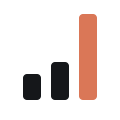

<p align="center">
  <picture>
    <source media="(prefers-color-scheme: dark)" srcset="assets/quota-mark-dark.svg">
    
  </picture>
</p>

# Claude Usage Tracker

A small service for a Raspberry Pi that:

- records how close a Claude account gets to its 5-hour session limit and 7-day weekly limit;
- rolls that up per day, including limit hits, usage-credit (overage) spend and, optionally, Claude Code token counts;
- syncs the daily rows to a Notion database;
- posts to Slack when collection breaks.

Polling is adaptive: every 30 s while usage is moving, backing off to every 5 min when idle.

See [DECISIONS.md](DECISIONS.md) for what was borrowed from prior art and why.

> **Unofficial, and it can break without notice.** This tool reads the same internal claude.ai endpoint the Settings > Usage page uses. Anthropic doesn't document or support it, and can change or remove it at any time. Changes so far have been additive: new keys and per-model limits moving into a `limits` list. If it breaks:
> - The tracker never mistakes a changed response for data. A missing field triggers a Slack alert and is stored as empty, and an HTML or Cloudflare page counts as a failed poll.
> - Every raw response is kept, so once the parser is fixed, `backfill-parse` recovers the history.
>
> This project isn't affiliated with or endorsed by Anthropic. Use it with your own account, and keep the polling rate modest.

```
claude.ai usage API ──► poller (systemd service) ──► usage.db (SQLite, WAL)
                                                         │
                             nightly timers: cc-tokens ─►│◄─ rollup ──► daily ──► sync ──► Notion
                                                         │
                         failures / thresholds ──► Slack webhook
```

## Install

On the Pi (Raspberry Pi OS 64-bit, Python 3.11+):

```sh
sudo apt install -y git gh                # if not already installed
gh auth login                             # the repo is private; choose GitHub.com, HTTPS, log in with a browser/code
gh repo clone prossm/claude-usage-tracker ~/claude-usage-tracker
cd ~/claude-usage-tracker
sudo ./install.sh
```

The clone is only the source for installing. The service runs from the copy `install.sh` puts in `/opt/claude-usage`. To upgrade later, run `git pull && sudo ./install.sh`.

`install.sh` is idempotent, so you can re-run it to upgrade. It does the following:

- creates the unprivileged user `claudeusage`;
- installs the code to `/opt/claude-usage/app` and a venv at `/opt/claude-usage/venv` (dependency: `curl_cffi`);
- creates `/opt/claude-usage/.env` from `.env.example` (mode 600, empty values) if it doesn't exist;
- installs the systemd units and the `claude-usage` command, which runs the CLI as `claudeusage`.

It never writes secrets.

Then:

```sh
sudo nano /opt/claude-usage/.env           # fill in the values, see below
claude-usage test-alert                    # Slack webhook works?
claude-usage poll --print-raw              # one manual poll; compare with claude.ai Settings > Usage
claude-usage sync --check                  # Notion database has the right properties?
sudo systemctl start claude-usage-poller
claude-usage status
```

**Timer timezone:** the nightly timers run at 00:05 (cc-tokens), 00:15 (rollup) and 00:30 (sync), in `TZ_NAME`. `install.sh` reads `TZ_NAME` from `.env` when it writes the timers, so if you change `TZ_NAME`, re-run `install.sh`.

## Configuration

All settings live in `/opt/claude-usage/.env` (owner `claudeusage`, mode `600`). Keep this file out of any backup that leaves the Pi. In cookie mode the session key is a full-account credential.

| Variable | Purpose |
|---|---|
| `CLAUDE_AUTH_MODE` | `cookie` (default) or `oauth` |
| `CLAUDE_SESSION_KEY` | Cookie mode: the `sessionKey` cookie value (`sk-ant-sid…`) |
| `CLAUDE_ORG_ID` | Optional org UUID; otherwise discovered (the org with `chat` capability) |
| `NOTION_TOKEN` | Notion internal integration token |
| `NOTION_DATABASE_ID` | Database ID, or just paste the database URL |
| `NOTION_DATA_SOURCE_ID` | Optional; only for a database with several data sources |
| `SLACK_WEBHOOK_URL` | Slack incoming webhook |
| `TZ_NAME` | e.g. `America/New_York`; defines a "day" |
| `CLAUDE_CODE_LOG_DIR` | Optional, e.g. `/home/pi/.claude/projects`; unset = token job skipped |
| `ALERT_WEEKLY_PCT` | Optional, e.g. `80`; one alert per weekly window when crossed |

Optional tuning variables (`POLL_*`, `CLAUDE_IMPERSONATE`, `CLAUDE_OAUTH_CREDENTIALS`) are documented in `.env.example`.

### Getting the `sessionKey` cookie

1. In a desktop browser, log in to <https://claude.ai>.
2. Open DevTools (F12 or Cmd-Opt-I):
   - **Chrome/Edge:** go to Application, then Storage, then Cookies, then `https://claude.ai`.
   - **Firefox:** go to Storage, then Cookies, then `https://claude.ai`.
3. Copy the **Value** of the `sessionKey` cookie. It starts with `sk-ant-sid`.
4. Put it in `.env` as `CLAUDE_SESSION_KEY=sk-ant-sid…`.

Logging out of claude.ai in that browser invalidates the key, so the usual practice is to grab it from a session you leave logged in. Keys expire every few weeks. When one does, you'll get a Slack alert.

### Replacing an expired session key

You'll know it has expired because Slack says *"auth failure … The claude.ai session key has likely expired"*. To replace it:

```sh
sudo nano /opt/claude-usage/.env     # paste the new CLAUDE_SESSION_KEY
claude-usage status                  # within one poll interval (max 5 min) it should recover
```

The poller notices that `.env` changed and reloads it, so no restart is needed. If you're impatient, run `sudo systemctl restart claude-usage-poller`. You'll get one "recovered" message in Slack.

### Notion setup

1. **Create an internal connection.** You must be the workspace owner.
   - In Notion's developer portal (<https://app.notion.com/developers/connections>), go to **Internal connections** and choose **Create a new connection**. If Notion asks for the connection type, choose **API token**.
   - Name it and pick your workspace.
   - On the **Configuration** tab, turn on the Read, Update and Insert content capabilities, then copy the API token (`ntn_…`) into `NOTION_TOKEN`.
   - Use this rather than a *personal access token*. A personal access token can reach everything you can reach in Notion; a connection can reach only what you share with it.
2. **Create a database** as a full-page table, with exactly these properties:

   | Property | Type |
   |---|---|
   | Day | Title |
   | Date | Date |
   | Max session % | Number |
   | Max weekly % | Number |
   | Session limit hit | Checkbox |
   | Weekly limit hit | Checkbox |
   | Credits spent | Number (format: US dollar) |
   | Overage | Checkbox |
   | Polls | Number |
   | CC input tokens | Number |
   | CC output tokens | Number |

3. **Share the database with the connection.** Do one of the following:
   - On the connection's **Content access** tab, choose **Edit access** and select the database.
   - On the database page, open the **•••** menu, choose **Connections**, then **+ Add connection**, and pick it.
4. **Copy the database URL** into `NOTION_DATABASE_ID`. The ID is the 32 hex characters before `?v=`; pasting the whole URL also works.
5. Run `claude-usage sync --check`. It lists any missing or mistyped property.

The tracker uses Notion API version `2026-03-11`, where a database contains one or more *data sources*. It finds the data source from the database ID by itself. If you've added a second data source to the database, `sync` stops and lists the data source IDs; put the right one in `NOTION_DATA_SOURCE_ID`.

Useful Notion views include a weekly-grouped table, a chart of *Max weekly %* by *Date*, and a filter on *Overage* is checked.

### Slack webhook

1. Go to <https://api.slack.com/apps>, choose **Create New App**, then **From scratch**, and pick your workspace. If Slack warns *"Your app can't do anything yet"*, choose **Create Anyway**; the next step adds the scope the app needs.
2. Open **Incoming Webhooks**, switch it on, then choose **Add New Webhook to Workspace** and pick the channel.
3. Copy the `https://hooks.slack.com/services/…` URL into `SLACK_WEBHOOK_URL`.
4. Optional: give alerts the tracker's icon. Under **Basic Information**, go to **Display Information**, upload [`assets/slack-app-icon.png`](assets/slack-app-icon.png) as the **App icon**, and set the background color to `#15171A`. That color sits behind the app name, which Slack draws in white, so it must be dark. Webhook messages use the app's icon; they can't set their own.
5. Run `claude-usage test-alert` to check it.

## Commands

All of these run as `claude-usage <command>`, which is a wrapper for `/opt/claude-usage/venv/bin/python /opt/claude-usage/app/claude_usage.py` as `claudeusage`.

| Command | What it does |
|---|---|
| `poll` | One poll, always persisted. `--print-raw` dumps the JSON, `--no-alert` mutes Slack |
| `poll --daemon` | The adaptive poller (run by `claude-usage-poller.service`) |
| `status` | Last successful poll, current %, resets, credits, current poll interval, recent intervals, days since last failure, open alerts |
| `rollup` | Recomputes yesterday, plus any of the previous 7 days whose polls changed. `--day YYYY-MM-DD`, `--all` |
| `sync` | Upserts changed daily rows to Notion. `--check` verifies the database only, `--force` re-sends everything |
| `cc-tokens` | Sums Claude Code tokens per day from `CLAUDE_CODE_LOG_DIR` (skipped if unset) |
| `backfill-parse` | Re-parses `raw_json` of every poll after a parser fix |
| `test-alert` | Sends a test Slack message |

### `status`

```
$ claude-usage status
Claude usage tracker  (auth: cookie, db: /opt/claude-usage/usage.db)
Last successful poll : Tue 2026-10-20 21:40 EDT (35s ago)
Session (5h)         :  42.0%  resets Tue 2026-10-20 23:00 EDT in 1h19m
Weekly (7d)          :  61.0%  resets Fri 2026-10-23 09:00 EDT in 2d
  seven_day_opus     :   3.0%
Usage credits        : $2.50 spent this month, $97.50 remaining
Poll interval        : 120s (last attempt 35s ago)
Consecutive failures : 0
Days since failure   : 3.2  (Sat 2026-10-17 14:02 EDT: HTTP 503)
Open alerts          : none
Recent intervals     : 21:02→30s  21:03→30s  21:05→60s  21:08→120s ...
Last Notion sync     : Tue 2026-10-20 00:30 EDT  (0 day(s) pending)
```

### After the API changes shape

If Slack says *"usage response changed shape"*, polling keeps going and the full raw JSON is still stored, but some parsed columns are NULL. To fix it:

```sh
claude-usage poll --print-raw            # see the new shape
# fix cusage/parse.py in the repo, then re-run: sudo ./install.sh
claude-usage backfill-parse              # re-parse every stored response
claude-usage rollup --all && claude-usage sync
```

## What the numbers mean

- **`max_session_pct` is a lower bound on the true peak.** The 5-hour window is rolling and polling is sampled: up to every 5 min when idle, every 30 s when usage is moving. The real maximum can fall between two polls, and a window can reset between polls. The same applies to `max_weekly_pct`, though it moves slowly enough that this rarely matters.
- **Session/weekly limit hit** means at least one poll that day read ≥ 100 %.
- **Credits spent** is the day's increase in month-to-date usage-credit spend (`extra_usage.used_credits`). A drop is treated as the monthly reset. **Overage** means credits spent > 0.
- **Polls** counts successful polls that day, including ones not written to `polls` because nothing changed.
- These are percentages of plan limits. Anthropic doesn't publish a conversion to tokens, and this tool doesn't attempt one.
- Data starts at the first successful poll. There is no backfill of earlier history.

## OAuth mode (alternative to the cookie)

If Claude Code is installed and logged in on the Pi, you can use `CLAUDE_AUTH_MODE=oauth`. The tracker then reads the access token from `~/.claude/.credentials.json` and polls `api.anthropic.com/api/oauth/usage`, with no cookie to re-paste.

**It is strictly read-only.** It never refreshes, rotates or writes that file. Refreshing from outside the CLI can revoke the live Claude Code session. When the on-disk token expires, running `claude` on the Pi renews it.

The file belongs to whichever user runs Claude Code, so give `claudeusage` read access and point the tracker at it:

```sh
sudo setfacl -m u:claudeusage:x /home/pi /home/pi/.claude
sudo setfacl -m u:claudeusage:r /home/pi/.claude/.credentials.json
# .env: CLAUDE_AUTH_MODE=oauth
#       CLAUDE_OAUTH_CREDENTIALS=/home/pi/.claude/.credentials.json
```

Before relying on it, compare `claude-usage poll` with Settings > Usage. The two sources have been reported to disagree.

The same ACL approach applies to `CLAUDE_CODE_LOG_DIR` (`setfacl -R -m u:claudeusage:rX /home/pi/.claude/projects`, plus a default ACL `-d` so new logs stay readable).

## Operations

```sh
journalctl -u claude-usage-poller -f                  # live poller log (secrets are scrubbed)
systemctl list-timers 'claude-usage-*'
sqlite3 /opt/claude-usage/usage.db 'SELECT polled_at, session_pct, weekly_pct, interval_s FROM polls ORDER BY id DESC LIMIT 20'
```

## Acceptance checklist

| Check | How |
|---|---|
| % match Settings > Usage | `claude-usage poll` then `status` |
| Poller speeds up and backs off | `status` → *Recent intervals*, or the `interval_s` column over a few hours |
| Daily row reaches Notion | after the first 00:30 run, or `claude-usage rollup && claude-usage sync` |
| Garbage key → exactly 1 alert, restore → 1 recovery | edit `.env`; the poller reloads it on change |
| `rollup` + `sync` twice → no duplicate pages | run them twice; sync upserts by page ID, then by Day search |
| Token job with `CLAUDE_CODE_LOG_DIR` unset | `claude-usage cc-tokens` logs "skipping" and exits 0 |
| HTML/Cloudflare is a failure | `polls.ok = 0`, auth alert; covered by `tests/test_parse_client.py` |

## Development

```sh
python3 -m unittest discover -s tests -t .     # no third-party deps needed for tests
```

Layout:

- `claude_usage.py`: entry point.
- `cusage/`: the code.
  - `client.py`: auth and HTTP.
  - `parse.py`: response parser.
  - `poller.py`: adaptive polling.
  - `rollup.py`: daily rollup.
  - `notion.py`: Notion sync.
  - `alerts.py`: Slack alerts.
  - `cctokens.py`: Claude Code token counts.
- `systemd/`: the unit files.
- `assets/`: the quota mark (light and dark SVG, favicon), and `slack-app-icon.png`, a 1024 px render for the Slack app.
- `install.sh`: the installer.

## License

MIT; see [LICENSE](LICENSE). Third-party attributions are in [THIRD_PARTY_NOTICES.md](THIRD_PARTY_NOTICES.md).
